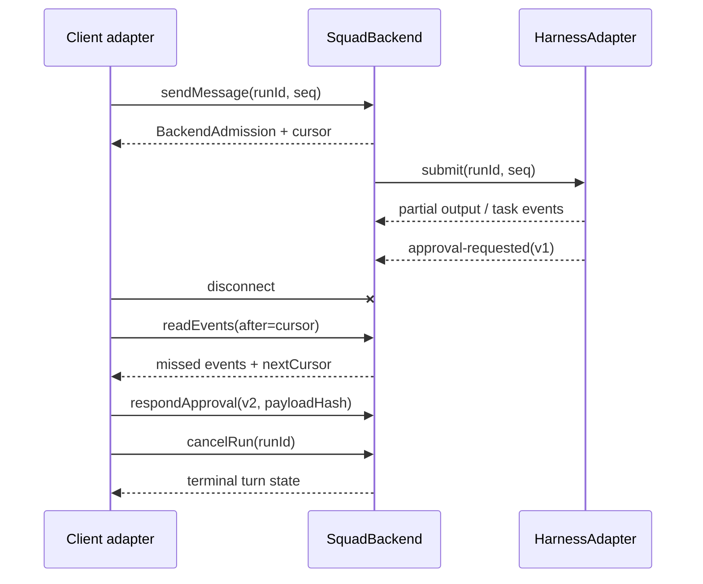
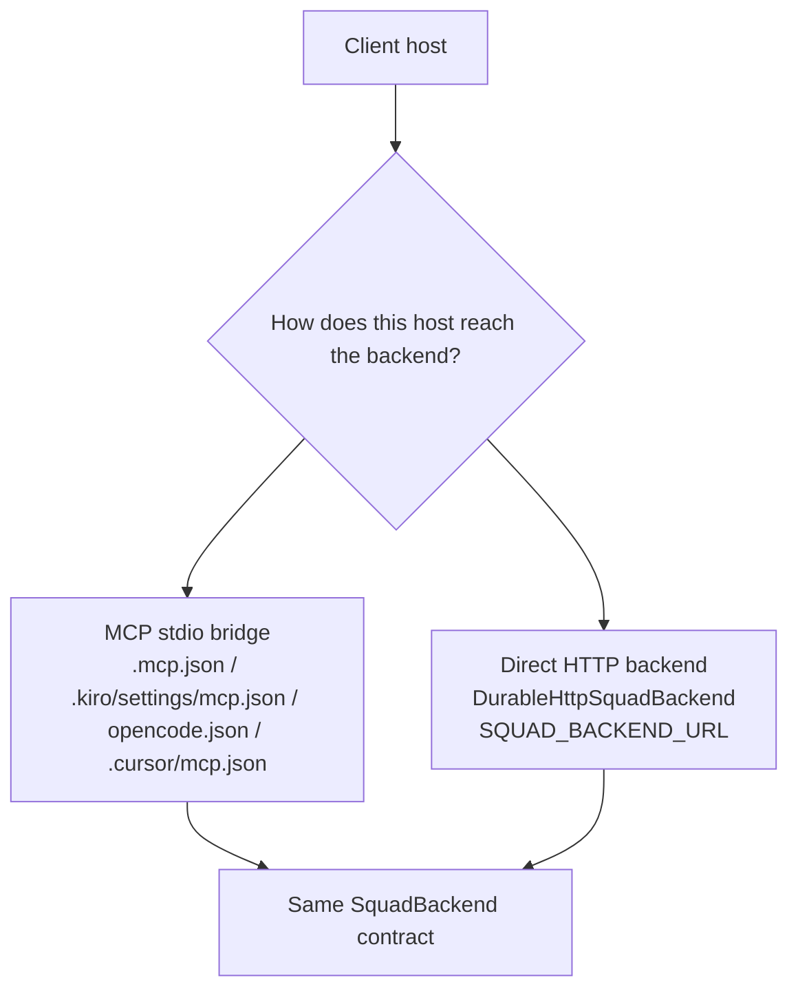

# Squad 2.0 Overview

Squad 2.0 is the architectural split that stops treating "the editor" and "the backend" as the same thing.

In Squad 1.x, a lot of the conversation model, routing assumptions, and execution behavior were effectively bundled with the host you happened to be using. That worked fine as long as your world was mostly one client, one runtime, one execution story.

Squad 2.0 is the version where we deliberately break that coupling.

The goal is simple:

- keep the **team experience** consistent;
- let the **host client** be native to Copilot, Claude Code, Kiro, OpenCode, or Cursor;
- let the **backend** stay local or move to **DurableSquad** over HTTP;
- let the **execution harness** evolve independently without rewriting every client projection.

That is what makes the same Squad team portable across hosts without turning the protocol into a pile of editor-specific hacks.

---

## Why Squad 2.0 exists

Squad 2.0 solves three practical problems.

### 1. The client should not own the conversation contract

A host can be fantastic at UI, subagents, or local tooling and still be a terrible place to define durable turn ordering, replay semantics, approvals, or cancellation. Those are backend concerns.

### 2. MCP is useful, but MCP is not the whole protocol

MCP is a great transport for exposing tools locally. It is not, by itself, the canonical wire contract for long-lived conversations, resumable event logs, versioned approvals, or `runId`-scoped cancellation.

### 3. Execution fabric changes faster than the team model

Sometimes you want local in-process execution. Sometimes you want a remote durable broker. Sometimes you want a custom harness. The team should not care. The protocol should.

---

## The 3-plane architecture

Squad 2.0 is intentionally split into three planes.

```mermaid
flowchart LR
    user[Developer] --> client

    subgraph CP[Client Plane\n@bradygaster/squad-sdk/clients]
      client[Host-native adapter\nCopilot / Claude / Kiro / OpenCode / Cursor]
      projection[Workspace projection\nagent files + MCP config + rules]
      caps[ClientCapabilities\ndispatch + transport modes]
      client --> projection
      client --> caps
    end

    subgraph BP[Control / Broker Plane\n@bradygaster/squad-sdk/backend]
      backend[SquadBackend / IConversationBackend]
      log[Durable ordered event log\nBackendEnvelope + monotonic seq]
      auth[Capability negotiation\nclient ∩ backend ∩ policy]
      approvals[Versioned approvals\nv1 requested -> v2 decided]
      resume[Opaque resume cursor\nlastAcceptedSeq + resumable]
      backend --> log
      backend --> auth
      backend --> approvals
      backend --> resume
    end

    subgraph EP[Execution Plane\nHarnessAdapter SPI]
      harness[HarnessAdapter]
      exec[Agent runs, tools, streaming, tasks]
      fence[Lease / epoch fencing\n(runId, seq) dedupe]
      harness --> exec
      harness --> fence
    end

    client --> backend
    backend --> harness
```

### Plane 1: Client Plane (`@bradygaster/squad-sdk/clients`)

The client plane is where Squad becomes native to the host you are actually using.

| Concern | What lives here | Examples |
|---|---|---|
| Workspace projection | Host-native files and config | `.mcp.json`, `.claude/agents/squad.md`, `.kiro/settings/mcp.json`, `.cursor/rules/squad.mdc` |
| Capability declaration | Host features the adapter can honestly claim | `ClientCapabilities`, `transportModes`, steering support, subagent support |
| Coordinator dispatch | How the coordinator asks the host to run specialists | Copilot `task` / `create_session` / `runSubagent`, Claude `Task`, OpenCode `@agent`, Cursor subagents |
| Workspace description | The normalized host view of root, working dir, agent anchor, and MCP config | the `projectWorkspace()` concept from the adapter profile |

The important rule is that the client plane owns **bootstrap and translation**, not conversation truth.

It decides things like:

- which files get generated for a client;
- how the host discovers the Squad coordinator;
- how that host dispatches specialists;
- whether the host reaches the backend through MCP, HTTP, or an in-process path.

It does **not** decide durable sequencing, authorization, approval validity, or replay semantics.

### Plane 2: Control / Broker Plane (`@bradygaster/squad-sdk/backend`)

This is the semantic center of gravity.

It owns the durable conversation contract through `SquadBackend` / `IConversationBackend`, including:

- the ordered event log (`BackendEnvelope`);
- per-conversation monotonic `seq`;
- stable `runId` independent from `seq`;
- opaque resume cursors and reconnect semantics;
- capability negotiation through `/v1/capabilities`;
- versioned approvals;
- `runId`-scoped cancellation;
- canonical error shapes.



A few details matter a lot here:

#### Durable ordered event log

`BackendEnvelope` is the canonical event shape. Every transport can project into it, but the meaning lives here.

#### Monotonic ordering

`seq` is the per-conversation ordering coordinate. It is how the broker preserves canonical history. It is not the thing you cancel.

#### Resume without leaking backend internals

Clients reconnect with opaque cursors. The backend returns `nextCursor`, `lastAcceptedSeq`, and `resumable`. The client treats that cursor as a token, not a structure.

#### Capability intersection

Effective behavior is negotiated, not guessed:

```text
effectiveCapabilities = clientCapabilities ∩ backendCapabilities ∩ policyCapabilities
```

That means:

- the client cannot grant itself powers it does not have;
- the backend cannot accidentally expose things policy denied;
- a config file cannot widen authority just because it listed an optimistic client slug.

#### Versioned approvals

Approvals are durable resources. The pattern is:

- **v1**: request is created;
- **v2**: request is decided;
- the decision must echo the immutable payload digest.

In the current SDK types the response field is named `hash`; in the protocol docs and fixtures you will also see this described as the approval payload hash. Same idea, same safety rule: no stale or mutated approval payload may execute.

#### `runId` cancellation

Cancellation targets the stable run lifecycle, not a host-local completion flag and not a turn sequence. That is why the backend exposes `cancelRun(conversationId, runId, reason?)`.

### Plane 3: Execution Plane (`HarnessAdapter` SPI)

This is where work actually runs.

A `HarnessAdapter` translates the broker contract into a concrete execution primitive such as a local session runner, a durable worker, or a provider-specific runtime.

| Concern | What lives here |
|---|---|
| Work submission | `submit(conversationId, runId, seq, ...)` |
| Event streaming | `subscribe(...)` |
| Lifecycle control | `cancel(...)`, `respondApproval(...)` |
| Runtime description | `describe()` |
| Vendor extensions | `x-<harness>.*` namespaces |

The broker expects the execution plane to respect these rules:

- extension keys stay in the `x-<harness>.*` namespace;
- duplicate submissions are harmless because the broker dedupes on `(runId, seq)`;
- lease / epoch fencing prevents stale workers from writing after a takeover;
- harness-specific behavior must not change the canonical conversation semantics.

---

## Why MCP is a transport bridge, not the wire contract

This distinction is the part that saves Squad 2.0 from turning into five subtly incompatible products.



### Local bridge path

A host can load Squad through local MCP configuration:

- `.mcp.json`
- `.kiro/settings/mcp.json`
- `opencode.json`
- `.cursor/mcp.json`

That is the **bridge**.

### Direct backend path

A host or application can also talk directly to the backend over HTTP using `DurableHttpSquadBackend` and `SQUAD_BACKEND_URL`.

That is a **different transport** reaching the same contract.

### Why the distinction matters

If MCP were the protocol, every host quirk would become protocol law.

If `SquadBackend` is the protocol, then:

- MCP stays useful for local tool transport;
- HTTP stays useful for durable remote operation;
- both still produce the same durable conversation semantics.

That is the whole game.

---

## Security and conformance gates (`G1`-`G9`)

Squad 2.0 is not "done" because the markdown says so. It is done when the gates hold.

| Gate | What it proves |
|---|---|
| `G1` | stable `runId` exists independently from turn ordering |
| `G2` | per-conversation ordering stays monotonic by `seq` |
| `G3` | approvals are durable, versioned resources with immutable payload hashes |
| `G4` | effective capabilities are negotiated as `client ∩ backend ∩ policy` |
| `G5` | reconnect is cursor-based and reports `lastAcceptedSeq` + `resumable` |
| `G6` | cancellation targets `runId`, not host-local completion state |
| `G7` | health probes stay outside the versioned protocol resource tree |
| `G8` | projections are loss-tolerant for unknown durable events and extensions |
| `G9` | the frozen fixtures and cross-adapter trace pass unchanged |

You can think of them in three buckets:

### Security / isolation

- path guards;
- non-clobbering MCP merges;
- no secrets in generated projections;
- stale writers get fenced.

### Protocol correctness

- ordering is monotonic;
- reconnect is resumable;
- approvals are versioned and hash-bound;
- cancellation is scoped to the run lifecycle.

### Conformance

- every adapter sees the same canonical history;
- unknown future events do not crash a projection;
- the golden fixtures remain immutable across implementations.

---

## The golden conformance trace

The canonical trace frozen under `squad-protocol-v2.0-rc1` is:

```text
TurnAccepted(runId, seq)
-> stream partial output
-> ApprovalRequested(v1)
-> disconnect
-> reconnect(cursor)
-> ApprovalDecided(v2)
-> CancellationRequested(runId)
-> terminal state
```

That trace sounds small. It is doing a lot of work.

It proves that the implementation can survive:

- streaming output before the approval boundary;
- disconnection and reconnect from an opaque cursor;
- exactly-once approval effects even after replay attempts;
- the cancel-versus-complete race;
- identical canonical history across Copilot, Claude, Kiro, OpenCode, and Cursor projections.

If one adapter renders prettier output than another, fine. If one adapter changes the canonical history, not fine.

---

## What this buys you in practice

When Squad 2.0 is wired correctly:

- you can initialize the same repo for multiple clients with `--client` projections;
- you can start local with MCP and later move to `DurableSquad` over HTTP;
- you can swap or add harnesses without rewriting client projections;
- you can reason about failures using one contract instead of five host-specific stories.

That is the point of the split.

Not more abstraction for its own sake. Less accidental coupling.

---

## Related docs

- `docs/tutorials/multi-client-quickstart.md`
- `docs/tutorials/durable-backend-and-custom-harness.md`
- `docs/src/content/docs/concepts/squad-2-0-architecture.md`
- `docs/src/content/docs/scenarios/using-squad-across-clients.md`
- `docs/src/content/docs/scenarios/client-compatibility.md`
