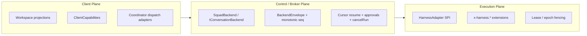
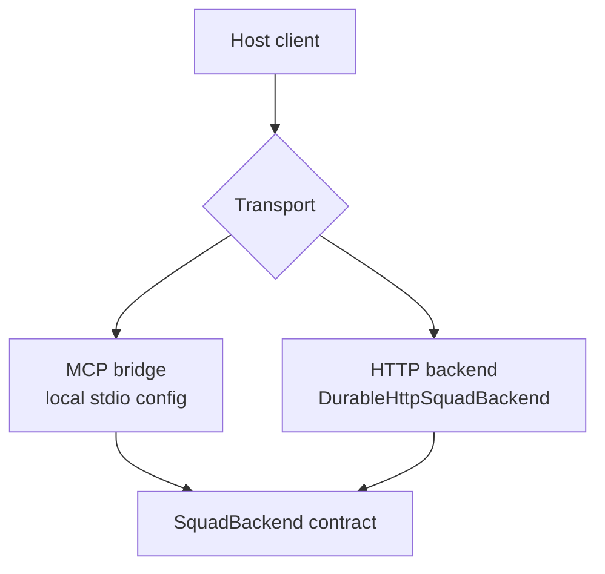

# Squad 2.0 architecture

Squad 2.0 is the version of Squad where the client host, the conversation backend, and the execution harness stop pretending to be one thing.

That split is what makes one team portable across GitHub Copilot, Claude Code, Kiro, OpenCode, and Cursor while still letting the backend stay local or move to DurableSquad.

## Why Squad 2.0 exists

We wanted three things at the same time:

- native host experiences in different clients;
- one durable conversation contract;
- pluggable execution runtimes.

The simplest way to get all three is to separate them.

## The three planes



### Client Plane

The client plane lives in `@bradygaster/squad-sdk/clients`.

Its job is to project Squad into the files and affordances a host already understands:

- Copilot: `.github/agents/squad.agent.md` and `.mcp.json`
- Claude Code: `.claude/agents/squad.md`, `CLAUDE.md`, `.mcp.json`
- Kiro: `.kiro/steering/squad.md`, `.kiro/agents/squad.json`, `.kiro/settings/mcp.json`
- OpenCode: `.opencode/agent/squad.md`, `opencode.json`
- Cursor: `.cursor/agents/squad.md`, `.cursor/rules/squad.mdc`, `.cursor/mcp.json`

The adapter profile also defines the normalized `projectWorkspace()` view so hosts can describe their root, working directory, anchor file, and MCP config consistently.

### Control / Broker Plane

The control plane lives in `@bradygaster/squad-sdk/backend`.

This is where the real contract lives:

- durable ordered event log via `BackendEnvelope`;
- monotonic per-conversation `seq`;
- opaque resume cursors;
- capability intersection through `/v1/capabilities`;
- versioned approvals;
- `runId`-scoped cancellation;
- canonical health and error semantics.

In short: the backend owns conversation truth.

### Execution Plane

The execution plane is the `HarnessAdapter` SPI.

Harnesses are allowed to be different. Their effects are not allowed to change the canonical conversation history.

That is why the broker enforces:

- `(runId, seq)` idempotency;
- `x-<harness>.*` vendor namespaces;
- lease / epoch fencing;
- durable approval and cancellation rules.

## MCP is a bridge, not the protocol

A host can reach the same backend in two ways:



That distinction matters.

- `.mcp.json`, `.kiro/settings/mcp.json`, `opencode.json`, and `.cursor/mcp.json` are **transport configuration**.
- `SquadBackend` is the **conversation contract**.

So a repo can start locally over MCP and later point at `SQUAD_BACKEND_URL` without rewriting every client projection.

## Security and conformance gates

Squad 2.0 compatibility claims are gated by `G1` through `G9`:

| Gate | Proof |
|---|---|
| `G1` | stable `runId` independent from turn ordering |
| `G2` | monotonic `seq` ordering |
| `G3` | durable versioned approvals with immutable payload hashes |
| `G4` | `client ∩ backend ∩ policy` capability intersection |
| `G5` | cursor-based recovery with `lastAcceptedSeq` and `resumable` |
| `G6` | `runId` cancellation |
| `G7` | health endpoints outside the protocol tree |
| `G8` | loss-tolerant unknown events and extensions |
| `G9` | immutable golden fixtures and cross-adapter trace |

## Golden conformance trace

The trace every adapter has to survive is:

```text
TurnAccepted(runId, seq)
-> ApprovalRequested(v1)
-> disconnect
-> reconnect(cursor)
-> ApprovalDecided(v2)
-> CancellationRequested(runId)
-> terminal state
```

If Copilot, Claude, Kiro, OpenCode, and Cursor all produce the same canonical history for that trace, the split is working.

## Read next

- [Using Squad across clients](../scenarios/using-squad-across-clients.md)
- [Client compatibility](../scenarios/client-compatibility.md)
