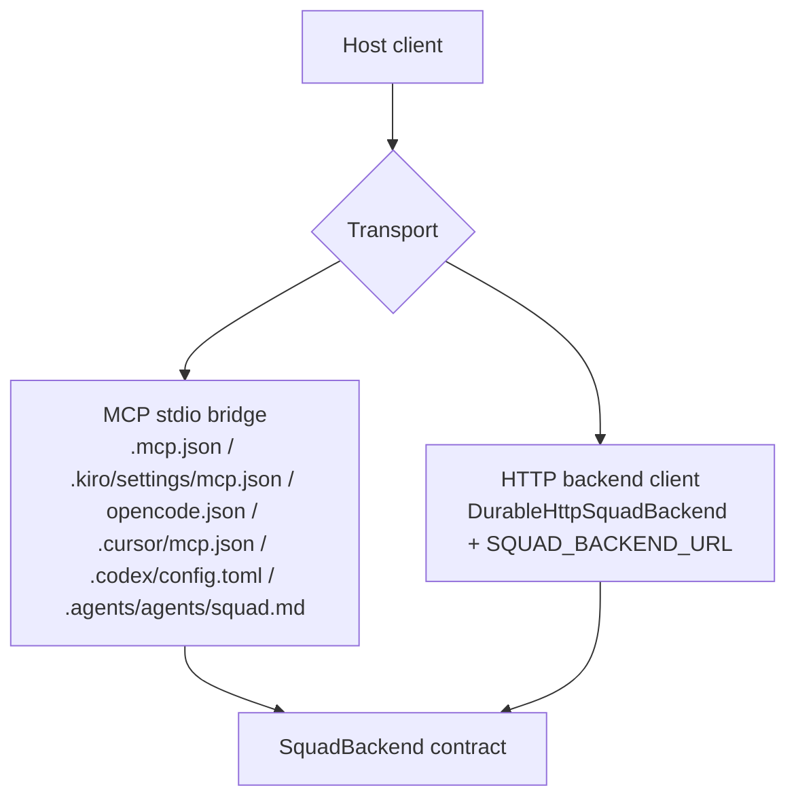

# Squad 2.0 architecture

Squad 2.0 is the version of Squad where the client host, the conversation backend, and the execution harness stop pretending to be one thing.

That split is what makes one team portable across all 7 supported hosts — GitHub Copilot, Claude Code, Kiro, OpenCode, Cursor, OpenAI Codex, and Google Antigravity (`copilot|claude|kiro|opencode|cursor|codex|antigravity|all`) — while letting the backend stay local or connect to an external `/v1/conversations` server.

## Why Squad 2.0 exists

Squad 2.0 separates three concerns that were coupled in Squad 1.x:

1. **Client hosts should not own the conversation contract.** Host editors and CLIs excel at UI, subagents, and local tooling, not durable turn ordering, replay semantics, hash-bound approvals, or `runId` cancellation.
2. **MCP is a local transport bridge, not the wire protocol.** MCP exposes tools locally, while the versioned `SquadBackend` contract owns long-lived conversations, resumable event logs, and capability negotiation.
3. **Execution fabrics change faster than the team model.** Whether work runs in-process, through a host subagent, or on a custom harness, the team roster in `.squad/` and the conversation history remain identical.

## The three planes

```mermaid
flowchart LR
    subgraph CP[Client Plane\n@bradygaster/squad-sdk/client]
      c1[HostProjection workspace files]
      c2[ClientCapabilities tokens]
      c3[ClientAdapter + coordinator dispatch]
    end

    subgraph BP[Control / Broker Plane\n@bradygaster/squad-sdk/backend]
      b1[SquadBackend / IConversationBackend]
      b2[BackendEnvelope + monotonic seq]
      b3[Cursor resume + approvals + cancelRun]
    end

    subgraph EP[Execution Plane\nHarnessAdapter SPI]
      e1[HarnessAdapter SPI]
      e2[x-harness.* extensions]
      e3[Lease / epoch fencing]
    end

    CP --> BP --> EP
```



### Plane 1: Client Plane (`@bradygaster/squad-sdk/client`)

The client plane lives in `@bradygaster/squad-sdk/client` (with `@bradygaster/squad-sdk/clients` kept as a deprecated alias). It owns host bootstrap, workspace file projection (`HostProjection`), capability declaration, and coordinator dispatch translation — never durable sequencing or authorization.

| Host (`ClientId`) | Generated workspace projection | Coordinator dispatch primitive |
|---|---|---|
| GitHub Copilot (`copilot`) | `.github/agents/squad.agent.md`, `.mcp.json` | Copilot `task` / `create_session` / `runSubagent` |
| Claude Code (`claude`) | `.claude/agents/squad.md`, `CLAUDE.md` (managed marker block), `.mcp.json`, `.gitignore` block for `.claude/worktrees/` | Claude `Task` subagent tool |
| Kiro (`kiro`) | `.kiro/steering/squad.md` (`inclusion: manual`), `.kiro/agents/squad.json`, `.kiro/settings/mcp.json` | Kiro `squad` agent referencing `../steering/squad.md` |
| OpenCode (`opencode`) | `.opencode/agent/squad.md`, `opencode.json` | OpenCode `@agent` / `task` primitive |
| Cursor (`cursor`) | `.cursor/agents/squad.md`, `.cursor/rules/squad.mdc` (`alwaysApply: false`), `.cursor/mcp.json` | Cursor subagents or inline charter turn |
| OpenAI Codex (`codex`) | `.codex/agents/squad.toml` (Codex custom agent with `developer_instructions`), `AGENTS.md` (short pointer block), `.codex/config.toml` (`[mcp_servers.squad_state]`) | Codex multi-agent specialist spawn |
| Google Antigravity (`antigravity`) | `.agents/agents/squad.md` (with `squad_state` MCP server in frontmatter), `GEMINI.md` (pointer block) | Antigravity `invoke_subagent` |

#### Host capability matrix (`CAPABILITY_TOKENS_BY_HOST`)

Each host adapter declares canonical capability tokens (`@bradygaster/squad-sdk/client`). Runtime capabilities are negotiated at the broker boundary via `effectiveCapabilities = clientCapabilities ∩ backendCapabilities ∩ policyCapabilities`:

| Host (`ClientId`) | Runtime capability tokens (`capability-matrix.json`) | Projection tokens | Transport modes |
|---|---|---|---|
| `copilot` | `approvals`, `background-runs`, `cancel-run`, `cursor-reconnect`, `mcp-bridge`, `subagents`, `typed-content-parts` | `native-hooks`, `steering-files` | `mcp-bridge`, `http-backend`, `in-process` |
| `claude` | `approvals`, `cancel-run`, `cursor-reconnect`, `mcp-bridge`, `subagents`, `typed-content-parts` | `native-hooks`, `steering-files` | `mcp-bridge`, `http-backend` |
| `kiro` | `approvals`, `cancel-run`, `cursor-reconnect`, `mcp-bridge`, `subagents`, `typed-content-parts` | `native-hooks`, `steering-files` | `mcp-bridge`, `http-backend` |
| `opencode` | `approvals`, `background-runs`, `cancel-run`, `cursor-reconnect`, `mcp-bridge`, `subagents`, `typed-content-parts` | `native-hooks` | `mcp-bridge`, `http-backend` |
| `cursor` | `approvals`, `cancel-run`, `cursor-reconnect`, `mcp-bridge`, `subagents`, `typed-content-parts` | `steering-files` | `mcp-bridge`, `http-backend` |
| `codex` | `approvals`, `cancel-run`, `cursor-reconnect`, `mcp-bridge`, `subagents`, `typed-content-parts` | `native-hooks`, `steering-files` | `mcp-bridge`, `http-backend` |
| `antigravity` | `approvals`, `cancel-run`, `cursor-reconnect`, `mcp-bridge`, `subagents`, `typed-content-parts` | `steering-files` | `mcp-bridge`, `http-backend` |

The adapter profile also defines the normalized `projectWorkspace()` view so hosts describe their root, working directory, anchor file, and MCP config consistently, while `.squad/config.json` persists only canonical portable client slugs in `clients[]`.

### Plane 2: Control / Broker Plane (`@bradygaster/squad-sdk/backend`)

> **Experimental Preview — Bring Your Own Server:** `@bradygaster/squad-sdk/backend` is an experimental extension contract (`BACKEND_CONTRACT_STAGE = 'experimental'`). Squad ships the `SquadBackend` / `HarnessAdapter` interfaces, the local file/state-store backend, and the outbound `durable-http` client — it does **not** bundle a remote DurableSquad server, and server-side DurableSquad Phase 2 integration (remote durable approvals and lease-epoch coordination) is pending. Use `durable-http` when connecting to your own external or managed `/v1/conversations` server.

The control plane lives in `@bradygaster/squad-sdk/backend` and owns conversation truth through `SquadBackend` / `IConversationBackend`:

- **Durable ordered event log (`BackendEnvelope`)** with per-conversation monotonic `seq` and `(runId, seq)` idempotency;
- **Stable `runId`** independent from turn `seq`, used for `cancelRun(conversationId, runId, reason?)`;
- **Opaque resume cursors** via `readEvents(conversationId, { after, limit, stream })` returning `nextCursor`, `lastAcceptedSeq`, and `resumable`;
- **Capability intersection** via `/v1/capabilities`: `effectiveCapabilities = clientCapabilities ∩ backendCapabilities ∩ policyCapabilities`;
- **Versioned hash-bound approvals** (`v1` requested → `v2` decided) where `respondApproval` verifies the immutable payload `hash`;
- **Canonical health and error envelopes** (`BackendError`, `/health/live`, `/health/ready`).

In `squad state-mcp`, the 11 `squad_backend_*` MCP conversation tools are **opt-in**: pass `--experimental-backend` or set `SQUAD_EXPERIMENTAL_BACKEND=1`. `SQUAD_BACKEND_URL` alone does not enable them. The bridge ships no execution harness: `squad_backend_health` / `squad_backend_negotiate` report `executionAvailable: false`, and `squad_backend_send_message` refuses instead of queueing (`unavailable` when no harness is registered; auto-selects a single registered in-process harness when `harness` is omitted, or refuses with `invalid-request` when multiple harnesses are registered), so over MCP the bundled backend is a transcript and event-log surface.

### Plane 3: Execution Plane (`HarnessAdapter` SPI)

The execution plane is the experimental `HarnessAdapter` SPI in `@bradygaster/squad-sdk/backend` (`submit`, `subscribe`, `cancel`, `respondApproval`, `describe`, registered via `DefaultHarnessRegistry`).

Harnesses translate broker turns into concrete runtime work while the broker enforces:

- `(runId, seq)` command and event deduplication;
- vendor extension isolation in `x-<harness>.*` namespaces via `validateExtensions()`;
- lease / epoch fencing (`X-Lease-Epoch`) so stale workers cannot overwrite newer broker state;
- durable approval and `runId` cancellation rules.

## MCP is a bridge, not the protocol

A host can reach the same `SquadBackend` contract in two ways:



- `.mcp.json`, `.kiro/settings/mcp.json`, `opencode.json`, `.cursor/mcp.json`, `.codex/config.toml`, and Antigravity's `.agents/agents/squad.md` frontmatter are **local transport configuration**.
- `SquadBackend` is the **conversation contract**.

A repository can start locally with the file/state-store backend and later connect `durable-http` via `SQUAD_BACKEND_URL` (an `https://` URL; plain `http://` only for localhost) (with `--experimental-backend` or `SQUAD_EXPERIMENTAL_BACKEND=1` on `squad state-mcp`) without rewriting its client projections.

## Security and conformance gates (`G1`–`G9`)

Squad 2.0 compatibility claims are gated by `G1` through `G9`:

| Gate | Proof |
|---|---|
| `G1` | stable `runId` independent from turn ordering |
| `G2` | monotonic `seq` ordering |
| `G3` | durable versioned approvals with immutable payload hashes |
| `G4` | `client ∩ backend ∩ policy` capability intersection |
| `G5` | cursor-based recovery with `lastAcceptedSeq` and `resumable` |
| `G6` | `runId` cancellation |
| `G7` | health endpoints outside the protocol tree |
| `G8` | loss-tolerant unknown events and extensions |
| `G9` | immutable golden fixtures and cross-adapter trace |

## Golden conformance trace

The canonical trace frozen under `squad-protocol-v2.0-rc1` that every adapter must survive is:

```text
TurnAccepted(runId, seq)
-> ApprovalRequested(v1)
-> disconnect
-> reconnect(cursor)
-> ApprovalDecided(v2)
-> CancellationRequested(runId)
-> terminal state
```

GitHub Copilot, Claude Code, Kiro, OpenCode, Cursor, OpenAI Codex, and Google Antigravity projections all observe the same canonical history for this trace across both the local backend and `durable-http`.

## Current scope and known limitations

- **Default `squad init` / `squad upgrade` is unchanged for Copilot-only repos:** non-Copilot projections and `.gitignore` lines (`.claude/worktrees/`, `NUL`) are strictly opt-in via `--client`.
- **Experimental `/backend` contract:** `@bradygaster/squad-sdk/backend` is exported only from the `./backend` subpath (`BACKEND_CONTRACT_STAGE = 'experimental'`). Server-side DurableSquad Phase 2 integration (remote durable approvals and lease-epoch coordination) is pending.
- **Cooperative epochs and unsigned cursors:** in the local and HTTP client implementation, lease epochs (`X-Lease-Epoch`) are cooperative fencing tokens for ordering/takeover hygiene rather than a cryptographic security boundary, and resume cursors are opaque base64url positions.
- **MCP bridge is transcript/event-log only by default:** `squad state-mcp` exposes the 11 `squad_backend_*` tools only when `--experimental-backend` or `SQUAD_EXPERIMENTAL_BACKEND=1` is passed, and bundles no execution `HarnessAdapter` (`executionAvailable: false`; `squad_backend_send_message` returns `unavailable` until a harness is registered).

## Read next

- [Using Squad across clients](../scenarios/using-squad-across-clients.md)
- [Client compatibility](../scenarios/client-compatibility.md)
- [Upgrading Squad](../scenarios/upgrading.md)
- [SDK Reference](../reference/sdk.md)
